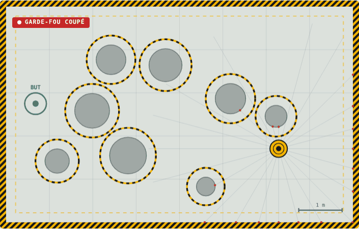

# Garde-fou

[](../../actions/workflows/verification.yml)

**Un réseau de neurones pilote un robot. Un filtre de sécurité garantit, preuve à l'appui, qu'il ne touche jamais rien.**



**[Essayer la démo](https://anesbouguettaya.github.io/garde-fou/)** : prenez les commandes et essayez de faire percuter un pilier au robot.

## Le problème

Un réseau de neurones peut très bien piloter un robot, jusqu'au jour où il se trompe. Ici, un petit réseau qui ne voit que son lidar a appris à rejoindre un but entre des piliers. Il y arrive souvent, mais sur 1 000 scènes jamais vues, **il percute un obstacle dans 8,6 % des cas**. Impossible de le mettre sur un vrai robot.

Plutôt que d'espérer qu'un meilleur entraînement règle le problème, Garde-fou sépare les rôles : **l'IA propose une vitesse, le garde-fou la corrige juste assez pour qu'elle soit sûre.** La sûreté ne dépend plus de la qualité de l'apprentissage. Elle repose sur une preuve de trois lignes, vérifiée par des tests.

## Résultats

1 000 scènes jamais vues pendant l'entraînement, 30 s au plus par scène. Chiffres produits par [`evaluer.py`](evaluer.py) et recalculés par l'intégration continue à chaque commit.

| Pilote | Sans garde-fou : but atteint | collision | Avec garde-fou : but atteint | collision | commandes corrigées |
|---|---:|---:|---:|---:|---:|
| **Réseau de neurones** (lidar, appris par imitation) | 79,6 % | 8,6 % | **87,6 %** | **0 %** | 1,8 % |
| Pilote naïf (tout droit vers le but) | 18,3 % | 81,7 % | 100 % | **0 %** | 38,2 % |
| Pilote hostile (vise le pilier le plus proche) | 0 % | 100 % | 0 % | **0 %** | 99,0 % |

- **Zéro collision** avec le garde-fou, quel que soit le pilote, même hostile. Sur 890 107 pas simulés, le robot n'est jamais passé à moins de 2 cm d'un obstacle, la distance de sécurité choisie.
- **Il rend aussi le réseau plus efficace** : 87,6 % de buts atteints au lieu de 79,6 %, car une erreur n'est plus fatale. Il ne corrige pourtant que 1,8 % des commandes du réseau : il n'intervient que lorsque c'est nécessaire.
- **Il garantit la sûreté, pas l'intelligence.** Ici, il suffit même au pilote naïf pour arriver partout, en le faisant glisser autour de chaque pilier, mais c'est alors lui qui conduit 38 % du temps. Dans un vrai bâtiment, avec des couloirs et des impasses, le pilote naïf resterait bloqué : il faut un pilote intelligent pour avancer, et un garde-fou pour ne rien casser.

## Comment ça marche

### 1. Le pilote propose

Un perceptron (27 entrées, 32 neurones, 2 sorties) choisit une vitesse 20 fois par seconde. Il voit la direction de son but et un lidar de 24 faisceaux, rien d'autre.

Il a appris **par imitation** ([`entrainer.py`](entrainer.py)). Le professeur connaît la carte : il calcule le chemin le plus court sur une grille de 5 cm (Dijkstra), en pénalisant la proximité des piliers comme la couche d'inflation de ROS Navigation. Il atteint 99 % de ses buts sans jamais rien toucher. L'élève apprend à reproduire ses vitesses avec son seul lidar, selon la méthode **DAgger** (Ross et al., 2011) : c'est l'élève qui conduit, le professeur corrige les situations où il s'est mis, et l'on réentraîne. Rétropropagation et Adam sont écrits à la main en numpy.

Résultat : imiter un professeur parfaitement sûr ne rend pas sûr. L'élève percute encore un obstacle dans 8,6 % des scènes.

### 2. Le garde-fou corrige

C'est un **filtre de sécurité par fonction barrière de contrôle** (*control barrier function*, CBF), une technique classique de la robotique sûre. Pour chaque pilier de centre *o*, on mesure la place libre :

```
h(p) = ‖p − o‖² − ρ²        où ρ = rayon du pilier + rayon du robot + 2 cm
```

Le garde-fou cherche la vitesse *u* **la plus proche** de celle du pilote qui respecte, pour chaque pilier et chaque mur :

```
2 (p − o) · u  ≥  −(γ / Δt) · h(p)
```

C'est un problème d'optimisation quadratique. En deux dimensions, sa solution exacte est soit la vitesse proposée, soit sa projection sur une contrainte, soit un coin entre deux contraintes : [`filtrer()`](garde_fou.py) essaie tous ces candidats et garde le plus proche. Il n'y a ni solveur ni itérations, et le calcul est vectorisé avec numpy pour simuler 1 000 robots à la fois.

### 3. Pourquoi c'est garanti

Au pas suivant, la place libre devient :

```
h(p + Δt·u) = h(p) + 2Δt (p − o)·u + Δt² ‖u‖²
            ≥ h(p) − γ·h(p)              (contrainte, et Δt² ‖u‖² ≥ 0)
            = (1 − γ)·h(p)  ≥  0
```

Le dernier terme est un carré : il ne peut qu'aider, la discrétisation joue donc en notre faveur. La place libre ne passe jamais sous zéro, par récurrence, pour toujours. Pour les murs, *h* est linéaire et le calcul est exact. Enfin, **rester sur place satisfait toujours toutes les contraintes** (leur second membre est négatif ou nul) : le problème n'est jamais sans solution, et le garde-fou a toujours une réponse.

## Les tests

`python -m unittest` lance 13 tests, en 40 secondes environ. Les vérifications ne réutilisent pas le code testé :

- **La garantie** : 300 scènes de 30 s, quatre pilotes (réseau, naïf, hostile, aléatoire). Aucun ne s'approche à moins de 2 cm.
- **Un témoin** : sans garde-fou, le pilote hostile touche à chaque fois. Le test précédent sait donc échouer.
- **Pas à pas** : sur 2 000 situations proches du contact, h(p + Δt·u) ≥ (1 − γ)·h(p) est recalculé indépendamment.
- **La correction minimale** : la sortie du filtre est comparée à un autre algorithme de projection, celui de Dykstra.
- **Le minimum d'intervention** : une commande déjà sûre passe au bit près, et le robot n'est jamais accéléré.
- **Le lidar** : comparé à une marche pas à pas de 0,1 mm, faisceau par faisceau.
- **La démo calcule comme Python** : sur 400 cas, [`docs/garde_fou.js`](docs/garde_fou.js) donne les mêmes commandes, mesures lidar et sorties du réseau, au milliardième près. La démo en ligne exécute donc l'algorithme testé.

GitHub Actions rejoue les tests sous Python 3.11 et 3.13, lance le banc d'essai (qui échoue à la moindre collision) et publie la démo sur GitHub Pages.

## Essayer chez soi

```bash
pip install numpy
python -m unittest                    # les 13 tests
python evaluer.py                     # le banc d'essai, environ une minute
python entrainer.py                   # réentraîner le réseau, environ deux minutes
python -m http.server -d docs         # la démo sur http://localhost:8000
```

## Organisation

| Fichier | Rôle |
|---|---|
| [`garde_fou.py`](garde_fou.py) | Le cœur : scènes, lidar, filtre de sécurité, simulation vectorisée |
| [`pilotes.py`](pilotes.py) | Le réseau de neurones, le pilote naïf et le pilote hostile |
| [`entrainer.py`](entrainer.py) | Le professeur (Dijkstra sur carte de coût) et l'imitation DAgger |
| [`evaluer.py`](evaluer.py) | Le banc d'essai sur 1 000 scènes |
| [`test_garde_fou.py`](test_garde_fou.py) | Les 13 tests |
| [`docs/`](docs) | La démo web : page, cœur en JavaScript, poids du réseau, résultats |

## Limites

- **Le modèle du robot est simple** : base omnidirectionnelle (roues mecanum) commandée en vitesse. Un robot différentiel de type TurtleBot demande une étape de plus (contrôler un point déporté), et un robot rapide doit tenir compte de son inertie (CBF d'ordre supérieur).
- **Les obstacles sont fixes et connus** : le garde-fou a besoin de leur position, par une carte ou par la perception. Des obstacles mobiles, des personnes par exemple, demandent de prévoir leur mouvement.
- **La garantie porte sur le modèle.** Sur un vrai robot, il faut intégrer à la distance de sécurité les erreurs de localisation et de suivi de vitesse.
- **Le garde-fou garantit la sûreté, pas l'arrivée** : face au pilote hostile, il empêche chaque choc mais le robot reste immobile.

## Prochaines étapes

- Un nœud ROS 2 qui filtre `/cmd_vel` entre la navigation et les moteurs, testé dans Gazebo sur un TurtleBot.
- Des obstacles mobiles, avec une prédiction de leur trajectoire.
- Le même principe pour les agents IA : laisser un LLM proposer des actions, et ne laisser passer que celles qui respectent des règles vérifiables.

---

Projet construit avec l'aide d'un assistant IA (Claude). Chaque résultat a été vérifié : c'est le rôle de la preuve, des tests et du banc d'essai.
